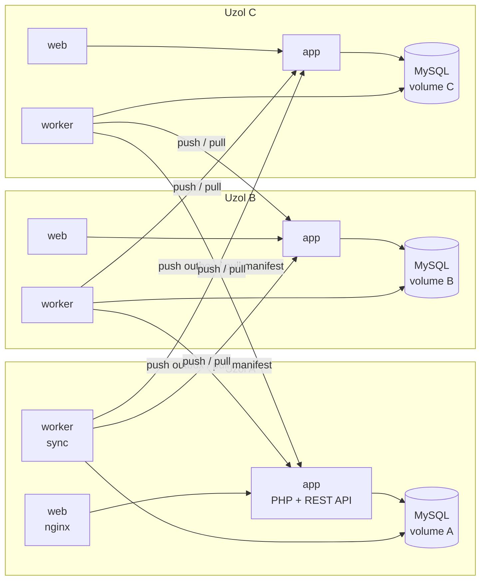

# Distribuovaná evidencia porúch kín – Variant 2 (kontajnerizovaný distribuovaný IS)

Tri kiná (uzly **A**, **B**, **C**) evidujú poruchy projektorov. Každý uzol beží v kontajneroch
s vlastnou databázou a vlastným persistentným volume. Záznam vytvorený na ľubovoľnom uzle sa replikuje
na ostatné. Pri výpadku uzol pracuje ďalej lokálne a po obnovení spojenia sa automaticky dosynchronizuje.

## Architektúra



| Kontajner | Úloha |
|---|---|
| `web` | nginx, vstupný bod uzla (zverejnený port), proxy na `app` |
| `app` | PHP 8.3 + Apache: webové rozhranie, stavový panel, REST API |
| `worker` | synchronizačný proces: push outboxu, anti-entropy pull, detekcia dostupnosti uzlov |
| `db` | MySQL 8.4, vlastný named volume pre každý uzol |

Všetky uzly používajú **rovnaký image `dt-node`**. Líšia sa iba konfiguráciou (`NODE_ID`, `PEER_NODES`, `DB_HOST`).

## Štruktúra projektu

```
Dockerfile                      jeden image pre app aj worker
docker-compose.yml              lokálna simulácia: 3 uzly na jednom PC + Dozzle
docker-compose.node.yml         1 uzol na 1 hostiteľa (VM, iný PC)
docker-compose.monitoring.yml   centrálne logy pre viac hostiteľov
docker-stack.yml                Docker Swarm + overlay sieť (3 VM)
config/local/node-*.env         konfigurácia uzlov pre lokálnu simuláciu
config/hosts/node-*.env.example vzor konfigurácie pre viac hostiteľov
src/lib/                        doménová logika, replikácia, synchronizácia
src/public/                     UI (index.php, assets) a REST API (api.php)
src/bin/worker.php              synchronizačný worker
scripts/                        nasadenie, simulácia výpadku
scripts/vm/                     automatické vytvorenie VirtualBox VM, nasadenie a test cez SSH
tests/defense.ps1               automatický scenár obhajoby (10 krokov)
_archive/                       pôvodný RAG chatbot (nepatrí k variantu 2)
```

## Dátový model

| Tabuľka | Obsah |
|---|---|
| `poruchy` | `id` (UUID v4), `origin_node` (pôvod a vlastník), `cislo_saly`, `popis`, `stav`, `version`, `created_at`, `updated_at`, `deleted_at` (tombstone), `checksum` (SHA-256) |
| `outbox` | neodoslané a odoslané operácie: `op_id`, `peer_node`, `op_type` (CREATE/UPDATE/DELETE), `version`, `payload`, `attempts`, `next_attempt_at`, `last_error`, `sent_at` |
| `inbox` | prijaté operácie podľa `op_id`: zabezpečuje idempotenciu |
| `peer_state` | dostupnosť ostatných uzlov, posledný push a pull, posledná chyba |
| `app_meta` | verzia schémy, heartbeat workera, počítadlo ignorovaných duplicít |

Schému vytvára aplikácia pri štarte, takže DB kontajner nepotrebuje žiadne pripojené súbory.

## Replikačný protokol

1. **Lokálna zmena:** zápis do `poruchy` a do `outbox` (jeden riadok pre každý peer) prebehne
   v **jednej transakcii**. Zmena sa tak nemôže stratiť ani pri páde.
2. **Push (worker, každé 2 s):** worker posiela dávky z outboxu na `POST /api/replicate`. Riadok označí
   ako odoslaný až po potvrdení od príjemcu, čo znamená doručenie **at-least-once**. Pri chybe nasleduje
   exponenciálny backoff (max. 30 s). Keď sa uzol znova pripojí, backoff sa zruší a odosiela sa okamžite.
3. **Príjem:** `op_id` sa zapíše do `inbox`. Ak tam už je, ide o duplicitu a operácia sa preskočí
   (**idempotencia**). Záznam sa uplatní, iba ak je jeho `version` vyššia ako lokálna. Staršia operácia
   doručená v nesprávnom poradí sa ignoruje. Príjemca kontroluje **checksum** a odmietne poškodené dáta.
4. **Pull / anti-entropy (každých 15 s a hneď po obnovení spojenia):** uzol porovná svoj manifest
   (`id:verzia:checksum`) s manifestom peera a dotiahne, čo mu chýba. Tak sa doplní aj stav, ktorý
   neprešiel cez outbox, napríklad nový alebo obnovený uzol.
5. **Vlastníctvo a konflikty:** upravovať a mazať môže iba `origin_node` (inak HTTP 403). Verzie záznamu
   teda rastú lineárne a konflikty pri bežnej prevádzke nevznikajú. Pri zhodnej verzii s rôznym obsahom
   rozhodne deterministicky väčší checksum, takže všetky uzly skončia v rovnakom stave.
6. **Mazanie:** záznam sa fyzicky nemaže. Nastaví sa `deleted_at` (tombstone), zvýši verzia a zmena sa
   replikuje ako každá iná.

## Spustenie: 3 uzly na jednom počítači

Požiadavky: Docker Desktop (Windows) alebo Docker Engine s Compose v2.

```powershell
powershell -ExecutionPolicy Bypass -File .\scripts\deploy-local.ps1
```

Skript vygeneruje `.env` s náhodným replikačným tokenom a heslami, zostaví image, spustí 13 kontajnerov
a počká, kým všetky health checky hlásia healthy.

| | URL |
|---|---|
| Uzol A | http://localhost:8081 |
| Uzol B | http://localhost:8082 |
| Uzol C | http://localhost:8083 |
| Centrálne logy (Dozzle) | http://localhost:8090 |

**Výpadok uzla B:** app a worker sa odpoja od replikačnej siete, UI na porte 8082 ostane dostupné.

```powershell
.\scripts\network.ps1 -Node B -Action disconnect
.\scripts\network.ps1 -Node B -Action connect
```

## Nasadenie na viac počítačov (PC + VM + ďalší PC)

Každý hostiteľ spustí jeden uzol pomocou `docker-compose.node.yml`. Uzly komunikujú cez IP adresy
v sieti LAN. Každý uzol má dva porty:

* `UI_PORT` (predvolene 8080) – webové rozhranie,
* `PEER_PORT` (predvolene 9080) – replikácia medzi uzlami (chránená tokenom).

### 1. Príprava hostiteľov

* **Windows PC:** Docker Desktop.
* **VM (VirtualBox / Hyper-V / VMware):** napríklad Ubuntu Server 24.04. Sieťový adaptér nastavte ako
  **Bridged** (premostený), aby VM dostala IP adresu v rovnakej LAN ako počítače. Docker nainštalujete takto:
  ```bash
  curl -fsSL https://get.docker.com | sudo sh
  sudo usermod -aG docker $USER   # potom sa odhláste a znova prihláste
  ```
* Zistite IP adresu každého hostiteľa (`ipconfig` / `ip a`) a overte, že sa navzájom vidia (`ping`).

### 2. Konfigurácia (na jednom počítači)

```powershell
.\scripts\new-host-configs.ps1 -IpA 192.168.1.10 -IpB 192.168.1.20 -IpC 192.168.1.30
```

Vzniknú súbory `config/hosts/node-a.env`, `node-b.env` a `node-c.env` so **spoločným** replikačným tokenom.
Celý priečinok projektu (vrátane `config/hosts`) potom skopírujte na každý hostiteľ, napríklad cez USB,
`scp -r` alebo git (v tom prípade súbory `.env` preneste zvlášť).

### 3. Spustenie uzla na každom hostiteľovi

```bash
# Linux VM (uzol B)
sh scripts/deploy-node.sh config/hosts/node-b.env
```
```powershell
# Windows PC (uzol A alebo C); -OpenFirewall ako administrátor otvorí porty vo Windows Firewalle
.\scripts\deploy-node.ps1 -EnvFile config\hosts\node-a.env -OpenFirewall
```

Skript zostaví image, spustí uzol, počká na health checky a vypíše dostupnosť ostatných uzlov.
Na Linuxe s aktívnym `ufw` povoľte porty: `sudo ufw allow 8080,9080/tcp`.

### 4. Výpadok uzla (uzol B na Linux VM)

```bash
sudo sh scripts/partition.sh on  config/hosts/node-b.env   # odpojí replikáciu, UI ostáva
sudo sh scripts/partition.sh off config/hosts/node-b.env   # obnoví spojenie
```

Alternatívy: na Windows hostiteľovi `scripts/partition.ps1` (blokuje replikačný port vo Windows Firewalle)
alebo fyzické odpojenie sieťového kábla / virtuálneho adaptéra VM.

### Automatické nasadenie uzla B na VirtualBox VM

Na Windows s VirtualBoxom sa dá celý uzol B vytvoriť bez ručnej inštalácie Linuxu:

```powershell
.\scripts\vm\create-virtualbox-vm.ps1      # Ubuntu 24.04 + Docker cez cloud-init, IP 192.168.56.20 (~5 min)
.\scripts\new-host-configs.ps1 -IpA 192.168.56.1 -IpB 192.168.56.20 -IpC 192.168.56.1
.\scripts\deploy-node.ps1 -EnvFile config\hosts\node-a.env    # uzol A na PC (port 8080)
.\scripts\deploy-node.ps1 -EnvFile config\hosts\node-c.env    # uzol C na PC (port 8180), kým nie je druhý PC
.\scripts\vm\deploy-to-vm.ps1                                  # skopíruje projekt na VM a spustí uzol B
.\scripts\vm\defense-vm.ps1                                    # scenár obhajoby, B sa odpája cez SSH + iptables
```

VM má tri sieťové adaptéry:

* NAT – prístup na internet,
* host-only `192.168.56.0/24` – spojenie PC ↔ VM,
* bridged Wi-Fi – adresa v LAN, cez ktorú VM uvidí iný počítač.

Bridged adaptér dostane adresu iba v sieti, ktorá to povoľuje: domáci router, hotspot z mobilu alebo kábel.
Školské a firemné Wi-Fi siete to často blokujú.

Prihlásenie: `ssh -i ~/.ssh/dt_vm_ed25519 dt@192.168.56.20`, na konzole VM `dt` / `dt-projekt`.

Po reštarte PC stačí spustiť Docker Desktop a VM (`VBoxManage startvm dt-node-b --type headless`).
Kontajnery sa spustia samy (`restart: unless-stopped`).

**Uzol C na druhom počítači:** na tomto PC spustite `.\scripts\setup-three-hosts.ps1 -FriendIp <IP druhého PC>`.
Skript urobí toto:

* ponechá existujúci token aj DB heslá,
* zastaví lokálny uzol C a prekonfiguruje uzol A,
* sprístupní uzol B cez porty tohto PC (VirtualBox port forwarding, takže netreba bridged sieť),
* vytvorí `config\hosts\node-c.env` pre druhý počítač.
Postup pre druhý počítač je v [docs/uzol-c.md](docs/uzol-c.md).

### 5. Centrálne logy pre viac hostiteľov (voliteľné)

Na každom uzle pridajte k príkazu `--profile logging` (spustí Dozzle agenta na porte 7007).
Na jednom počítači potom spustite:

```powershell
$env:DOZZLE_AGENTS = "192.168.1.10:7007,192.168.1.20:7007,192.168.1.30:7007"
docker compose -f docker-compose.monitoring.yml up -d    # http://localhost:8099
```

### Alternatíva: Docker Swarm s overlay sieťou

Táto možnosť sa hodí, ak sú všetky tri hostitele Linux VM. Postup je v hlavičke súboru `scripts/deploy-swarm.sh`:
`swarm init/join`, štítky `dt_node=a|b|c`, build image na každom hostiteľovi a `sh scripts/deploy-swarm.sh`.
Uzly komunikujú cez overlay sieť `replication`, každý uzol je pripnutý na svoj hostiteľ s lokálnym volume
a UI beží na porte 8080 každého hostiteľa. Docker Desktop na Windows sa ako člen multi-host Swarmu nehodí,
pretože beží v NAT-ovanej VM.

## Scenár obhajoby (automatický test)

```powershell
# lokálne – odpojenie aj reštart urobí skript sám
powershell -ExecutionPolicy Bypass -File .\tests\defense.ps1

# viac hostiteľov – v krokoch 3, 6 a 10 skript počká, kým uzol B ručne odpojíte, pripojíte alebo reštartujete
powershell -ExecutionPolicy Bypass -File .\tests\defense.ps1 -Manual `
    -A http://192.168.1.10:8080 -B http://192.168.1.20:8080 -C http://192.168.1.30:8080 -Token <REPLICATION_TOKEN>
```

Skript prejde všetkých 10 krokov zo zadania:

1. spustenie uzlov,
2. replikácia záznamu z A,
3. odpojenie B,
4. zápisy na A aj B vrátane úpravy, zmazania a pokusu o úpravu cudzieho záznamu,
5. synchronizácia počas výpadku → HTTP 503 a nič sa nestratí,
6. obnovenie spojenia,
7. kontrola, že sa doplnili všetky operácie,
8. 3× synchronizácia a 3× doručenie tej istej operácie → žiadne duplicity,
9. porovnanie manifestov, počtov, ID, verzií a checksumov,
10. reštart uzla a kontrola, že dáta ostali zachované.

Lokálne prechádza **28/28 kontrol**.

## REST API

| Endpoint | Popis |
|---|---|
| `GET /api/status` | stav uzla: počty, manifest hash, outbox, inbox, worker, peery |
| `GET /api/cluster` | stav všetkých uzlov (pre stavový panel) |
| `GET/POST /api/records`, `GET/PUT/DELETE /api/records/{id}` | CRUD; úprava a mazanie iba na uzle vlastníka |
| `GET /api/outbox` | neodoslané operácie |
| `POST /api/sync` | manuálna synchronizácia; ak je niektorý uzol nedostupný, vráti 503 |
| `GET /api/integrity` | prepočet checksumov všetkých uložených záznamov |
| `POST /api/replicate`, `GET /api/manifest`, `POST /api/export` | iba medzi uzlami, vyžadujú `X-Replication-Token` |
| `GET /health.php` | health check (aplikácia + DB) |

## Monitoring a bezpečnosť

* **Health checks:** db (`mysqladmin ping`), app (`/health.php`), worker (heartbeat v DB, max. 30 s), web.
  Všetky kontajnery majú `restart: unless-stopped`, Swarm má `restart_policy: any`.
* **Logy:** štruktúrované JSON riadky s `node`, `event`, `op_id` a `peer` (napr. `push_done`,
  `operation_duplicate`, `peer_recovered`), ktoré centrálne zbiera Dozzle.
* **Bezpečnosť:**
  * replikačné endpointy chráni zdieľaný token (porovnanie cez `hash_equals`),
  * tajomstvá sú v `.env` mimo gitu,
  * databázy sú iba v privátnej sieti uzla,
  * všade sa používajú prepared statements a escapovanie výstupu,
  * zápisy z prehliadača vyžadujú vlastnú hlavičku (ochrana proti CSRF),
  * odosielajú sa bezpečnostné HTTP hlavičky.
* **Obmedzenia:** UI nemá prihlasovanie používateľov (uzol je určený pre lokálnu sieť kina) a komunikácia
  medzi uzlami ide cez HTTP. V produkcii by bolo vhodné TLS, napr. reverse proxy s certifikátom.

## Mapovanie na bodovanie

| Oblasť | Riešenie |
|---|---|
| Funkčná aplikácia, dátový model | CRUD porúch, stavy, verzie, tombstone, outbox/inbox |
| Tri uzly s vlastnou perzistenciou | 3× MySQL s vlastným volume, rovnaký image, rôzne `NODE_ID` |
| Replikácia počas prevádzky | outbox + worker (push každé 2 s) |
| Jedinečné ID, pôvod, integrita | UUID v4, `origin_node`, SHA-256 checksum s kontrolou pri príjme |
| Autonómna práca počas výpadku | lokálny zápis vždy uspeje, UI ostáva dostupné |
| Trvalá evidencia neodoslaných operácií | tabuľka `outbox` v DB uzla (prežije reštart) |
| Úplná synchronizácia po obnovení | push s okamžitým zrušením backoffu + anti-entropy pull podľa manifestu |
| Idempotencia, úpravy, mazanie, konflikty | `inbox` podľa `op_id`, verzie, vlastníctvo, tombstone, deterministické riešenie |
| Monitoring, testy, bezpečnosť | stavový panel, health checks, Dozzle, `tests/defense.ps1`, token |
| Variant 2: kontajnerizácia, sieť, nasadenie | Compose, Swarm stack, overlay, deploy skripty, oddelené siete |

## Zadanie

Pôvodné zadanie: [DSD-zadanie-na-projekt-2026.docx](DSD-zadanie-na-projekt-2026.docx) · https://share.gemini.google/CuDLo9pfY5Tv


Variant 2: Kontajnerizovaný distribuovaný IS
Každý uzol bude obsahovať minimálne:
•	kontajner webovej aplikácie alebo REST API, 
•	databázový kontajner, 
•	voliteľne samostatný synchronizačný worker, 
•	vlastný persistentný volume. 
Nasadenie bude definované pomocou Docker Compose alebo obdobného nástroja. Všetky uzly používajú rovnaký obraz aplikácie, ale odlišnú konfiguráciu NODE_ID.
Minimálne požiadavky:
•	spustenie troch uzlov z konfiguračných súborov, 
•	vlastná databáza pre každý uzol, 
•	automatická alebo manuálna online replikácia, 
•	zachovanie údajov po reštarte kontajnera, 
•	jednoduchý stavový panel uzlov. 
Rozšírené riešenie:
•	odpojenie jedného uzla od siete, 
•	lokálne pokračovanie práce, 
•	trvalé uloženie neodoslaných operácií, 
•	automatická synchronizácia po pripojení, 
•	idempotentné opakovanie operácií, 
•	health checks, centralizované logovanie a automatické nasadenie. 
Tri kontajnery na jednom počítači sú vhodné na základnú simuláciu. Pre plné hodnotenie by som požadoval tri virtuálne stroje alebo viac Docker hostiteľov. Docker overlay sieť je určená práve na komunikáciu kontajnerov medzi viacerými Docker hostiteľmi a využíva Swarm režim. Docker – overlay networks
